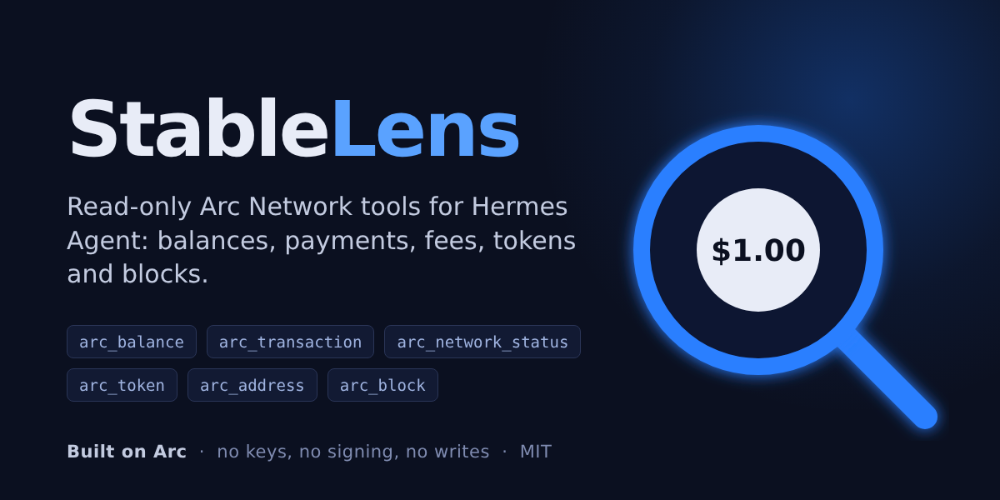

# StableLens



Read-only tools for [Hermes Agent](https://github.com/NousResearch/hermes-agent) that let the agent
look at Arc Network, the stablecoin-native L1 where USDC is the gas token. Ask Hermes what an
address holds, whether a payment went through, what a transfer costs, or what a token contract
is, and it answers from the chain. Built on Arc.

StableLens never signs, sends, holds keys or writes files. It only reads public chain data.

## Tools

| Tool | What it answers |
|---|---|
| `arc_network_status` | Latest block and its time, gas price, and what a plain transfer costs in USDC |
| `arc_balance` | An address's native USDC (gas) balance and its USDC, EURC, USYC, cirBTC and WETH balances, plus any ERC-20 you add, all read at one block |
| `arc_transaction` | Success, reverted or pending; block and time; the fee paid in USDC; the ERC-20 transfers it made; Circle contract names (CCTP, Gateway, ...) for known addresses |
| `arc_address` | Contract or account, nonce, native USDC balance, and Circle's name for it if it is a published contract |
| `arc_token` | Name, symbol, decimals and total supply of any ERC-20, by address or by Circle token symbol |
| `arc_block` | Number, hash, time, transaction count, gas used and base fee of a block |

Every tool takes an optional `network`: `mainnet` (chain 5042, the default) or `testnet`
(chain 5042002).

Example prompts:

- "How much USDC and EURC does 0x77777777Dcc4d5A8B6E418Fd04D8997ef11000eE hold on Arc?"
- "Did transaction 0x… on Arc succeed, and what did it cost?"
- "What does sending USDC on Arc cost right now?"

## How it reads the chain

- **Arc's public RPC endpoints**, the same list viem ships for Arc: `rpc.mainnet.arc.io`,
  Blockdaemon, dRPC and QuickNode (and their testnet counterparts). If one endpoint is down,
  rate-limited or returns something that is not JSON-RPC, the next one is tried. The endpoint that
  answered last is tried first.
- **Every endpoint proves its chain first.** Before an endpoint's answers are used it is asked for
  `eth_chainId`; an endpoint on another chain is never used, so a wrong URL cannot return another
  network's balances.
- **One block per answer.** All reads in a tool call are pinned to the same block, so a balance
  list is a consistent snapshot.
- **Exact amounts.** Raw integers are formatted with integer arithmetic, never floats, and every
  amount is returned both raw and formatted. Native USDC (gas) has 18 decimals; the USDC ERC-20
  interface at `0x3600…0000` reads the same balance with 6 decimals. Both are shown and labelled.
- **Bounded.** Each request has a timeout (10 s by default) and each tool call a 25 s deadline;
  responses over 4 MiB are refused, including after gzip decompression (one public endpoint
  sends gzip even when it was not asked to, so compressed answers are decoded). A failure comes back as a JSON error the agent can read; no
  tool call raises into Hermes or hangs an unattended run.
- **Checked addresses.** A mixed-case address with a wrong EIP-55 checksum is rejected, which
  catches a mistyped character. Addresses are returned in checksummed form.
- **No dependencies.** Standard library only, including a pure-Python Keccak-256 that the tests
  check against published vectors and against `hashlib`'s SHA3.

Token and contract addresses come from Arc's contract address reference and are checked against
the chain by the live tests (`symbol()` and `decimals()` of every token, code at every contract).

## Install

```bash
hermes plugins install stablelens        # from the plugin catalog
# or from this repository:
hermes plugins install https://github.com/erhnysr/stablelens
hermes plugins enable stablelens
```

## Settings

Under `plugins.entries.stablelens.settings` in `config.yaml`, or the plugin's page in the
Desktop's Settings → Plugins:

| Key | Default | Meaning |
|---|---|---|
| `network` | `mainnet` | Network used when a call does not name one |
| `timeout_seconds` | `10` | Per-request timeout, 1 to 30 |
| `mainnet_rpc_url` (secret) | empty | Your own mainnet endpoint, tried before the public ones |
| `testnet_rpc_url` (secret) | empty | Your own testnet endpoint, tried before the public ones |

A private endpoint URL usually contains your provider's API key, so the two endpoint settings are
Hermes secrets: they are stored in your profile's `.env` as `STABLELENS_MAINNET_RPC_URL` and
`STABLELENS_TESTNET_RPC_URL` (the Desktop's plugin page writes them there) and read through
Hermes's profile-aware secret scope, never from `config.yaml`. Only the endpoint's host name ever
appears in tool output or errors, never its path or key. Endpoints must be `https://`; `http://`
is accepted only for `localhost` / `127.0.0.1`, for a local node.

## Disclosure

- **Network calls:** each tool call sends JSON-RPC requests to Arc's public RPC endpoints, operated
  by Arc/Circle (`rpc.mainnet.arc.io`, `rpc.testnet.arc.io`), Blockdaemon, dRPC and QuickNode, or
  to the private endpoint you configure. The requests contain the addresses, transaction hashes,
  token addresses and block numbers the agent asks about. Nothing else is sent, and nothing is
  sent when no tool is called. Registration makes no network calls.
- **Credentials:** none are needed. An optional private endpoint URL is a Hermes secret, read only
  through Hermes's secret scope.
- **No keys, no writes, no shell, no background processes, no telemetry.** StableLens reads
  public chain data only. It stores nothing on disk and starts no processes.

## Development

```bash
python -m pytest                          # offline unit tests against a fake chain
STABLELENS_LIVE=1 python -m pytest        # plus live checks against Arc mainnet and testnet
hermes plugins validate . --install-deps  # the check the plugin catalog runs
```

## License

MIT
